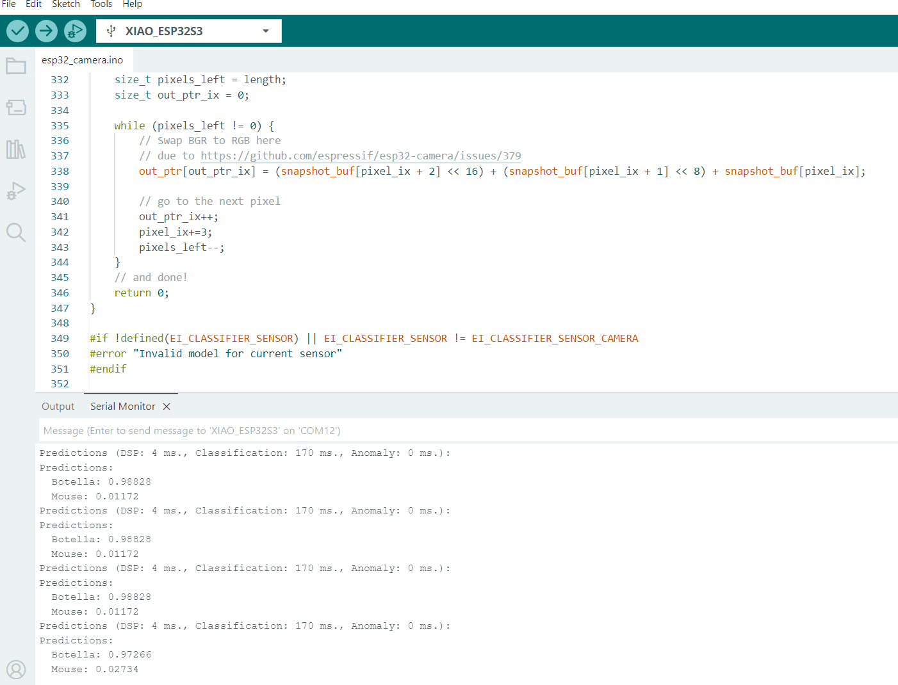
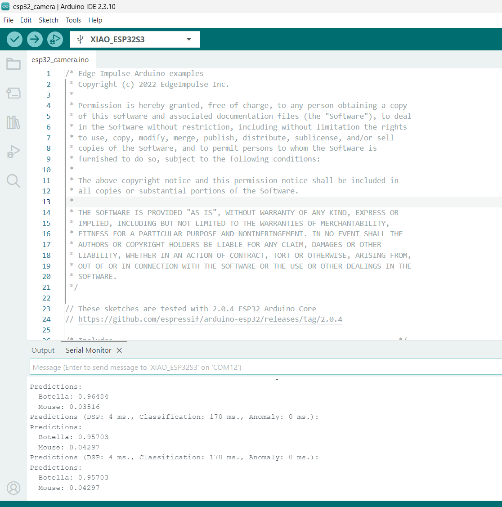
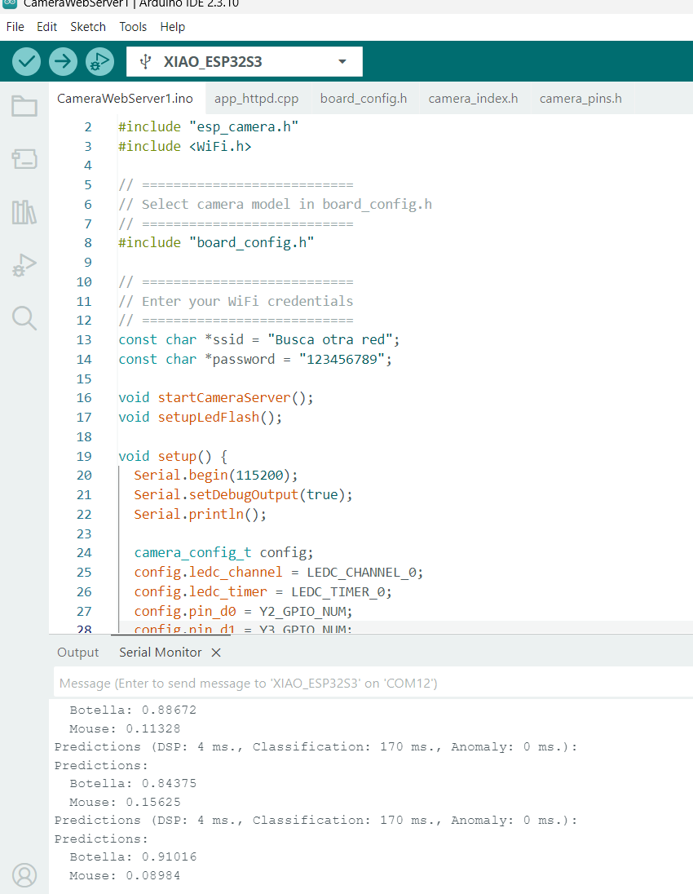
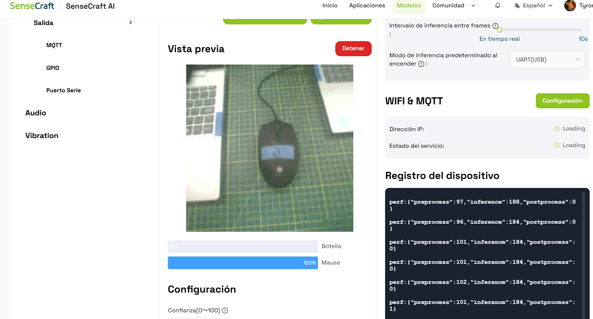
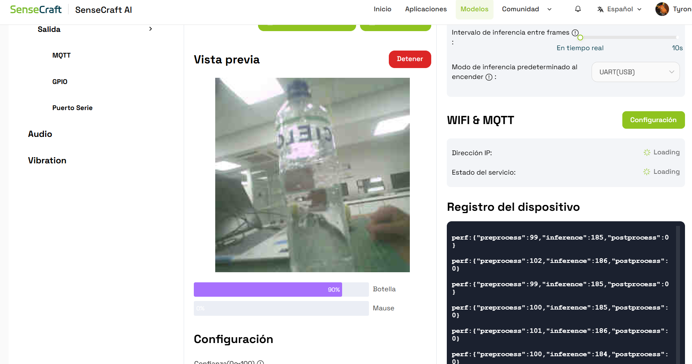
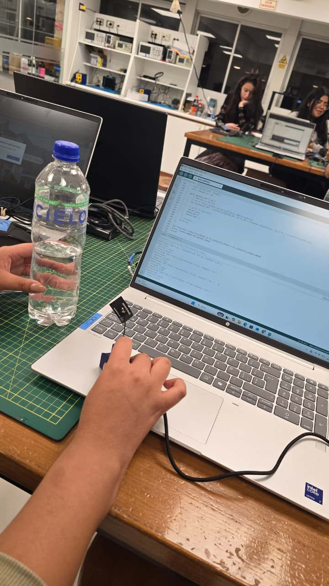
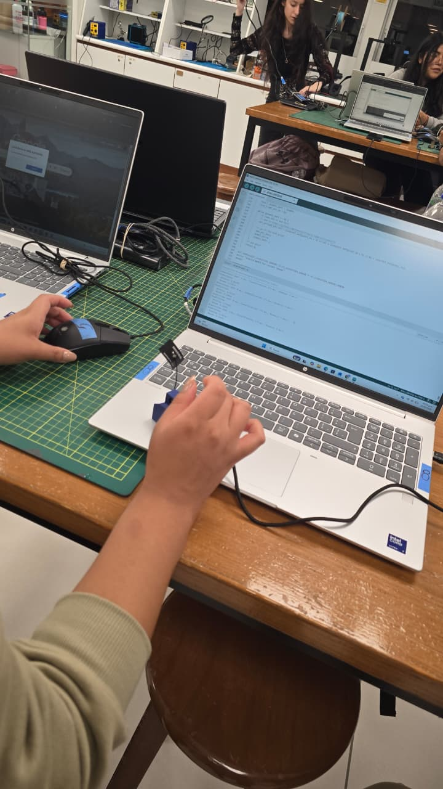

# Taller TinyML: reconocimiento de botella y mouse

En este taller trabajamos con una cámara y una placa XIAO ESP32S3 para diferenciar una botella de un mouse. Revisamos los resultados en Arduino IDE y realizamos pruebas en SenseCraft AI.

## Dataset y modelo

Usamos dos grupos de imágenes, uno para cada objeto. Los tres archivos ZIP están en la carpeta principal del repositorio.

| Archivo | Contenido |
|---|---|
| [botella_images_50.zip](botella_images_50.zip) | 50 imágenes de botella |
| [mouse_images_50.zip](mouse_images_50.zip) | 50 imágenes de mouse |
| [gg.zip](gg.zip) | Modelo entregado en el archivo `gg.lite` |

**Nota:** el ZIP de botellas tiene su carpeta interna llamada `mouse`, pero las muestras revisadas son de botellas. Hay que cargar ese grupo con la etiqueta Botella y extraer los dos datasets por separado.

## Fotos y resultados del taller

### 1. Prueba de botella en Arduino

En el monitor serie aparece Botella con una confianza de aproximadamente **98.83 %**. El valor de Mouse es mucho menor, por lo que el modelo selecciona Botella.

### 2. Prueba de mouse en Arduino

En esta prueba la mayor confianza corresponde a Mouse y llega a **99.61 %**. Así podemos ver el cambio de resultado entre las dos clases.

### 3. Segunda prueba de botella

Se muestran nuevas lecturas de Botella, con valores cercanos al **96 %**. Aunque la confianza cambia un poco, Botella sigue siendo la clase con mayor puntuación.

### 4. Código de la cámara

Aquí está abierto el ejemplo `CameraWebServer1`, donde se configura la cámara y la conexión Wi-Fi. Abajo también se ven lecturas de Botella entre **84 % y 91 %**, aunque el código abierto no necesariamente es el que está ejecutándose en la placa.

### 5. Mouse en SenseCraft AI

La cámara muestra el mouse sobre la mesa y SenseCraft indica **100 %** para la etiqueta “Mause”, que corresponde al mouse. En esa captura, Botella aparece con 0 %.

### 6. Botella en SenseCraft AI

Al colocar la botella frente a la cámara, SenseCraft muestra **90 %** para Botella. La vista previa permite ver el objeto que se está evaluando.

### 7. Prueba física con la botella

En esta foto se ve la prueba realizada en el laboratorio: colocamos la botella frente a la cámara y revisamos la salida en la computadora, con Arduino IDE abierto.

### 8. Prueba física con el mouse

Aquí se repite la prueba usando el mouse. Se observa la cámara apuntando hacia el objeto y la computadora utilizada para revisar los resultados.

## Resumen de resultados

| Prueba | Resultado mostrado |
|---|---|
| Botella en Arduino | 98.83 % |
| Mouse en Arduino | 99.61 % |
| Segunda prueba de botella en Arduino | 96.48 % |
| Mouse en SenseCraft | 100 % |
| Botella en SenseCraft | 90 % |

Estos porcentajes son la confianza de las lecturas mostradas, no la exactitud general del modelo.

## Conclusión

En las pruebas observamos resultados para los dos objetos tanto en Arduino como en SenseCraft. La confianza cambió entre las capturas, pero las pruebas de SenseCraft mostraron la clase correspondiente al objeto que estaba frente a la cámara.
